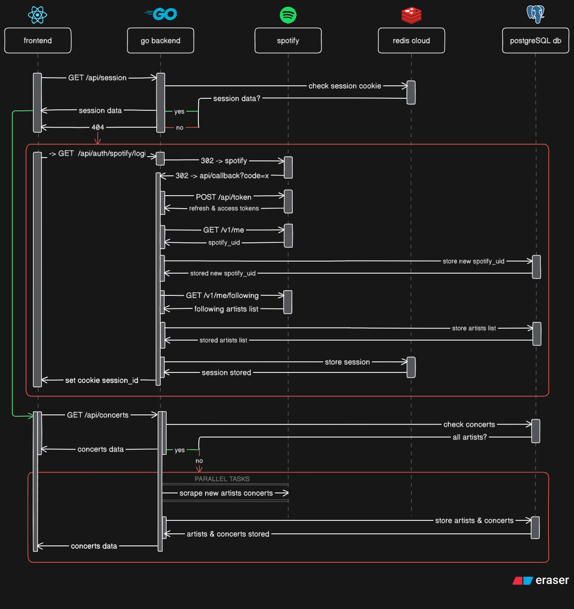

# nabis

a concert discovery platform that syncs with your spotify account and creates a feed of active and planned concerts of your favorite artists across the globe

---

## tldr
#### problem
me and other ukrainians have to travel abroad to attend concerts of our favorite artists. existing apps like bandsintown and spotify itself show active concerts only for your country or strictly in the max radius of 250kms

#### solution
nabis is a web platform that syncs with user's spotify account, fetches its following artists list and searches for all of the active concerts these artists have planned across the globe. this data is then displayed as a feed and a map

#### stack
- go backend
- react native frontend
- redis cloud for cookies
- postgreSQL to store users and concerts
- spotify api

#### workflow diagram
